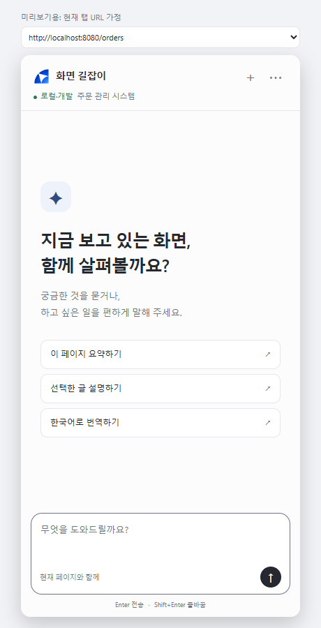
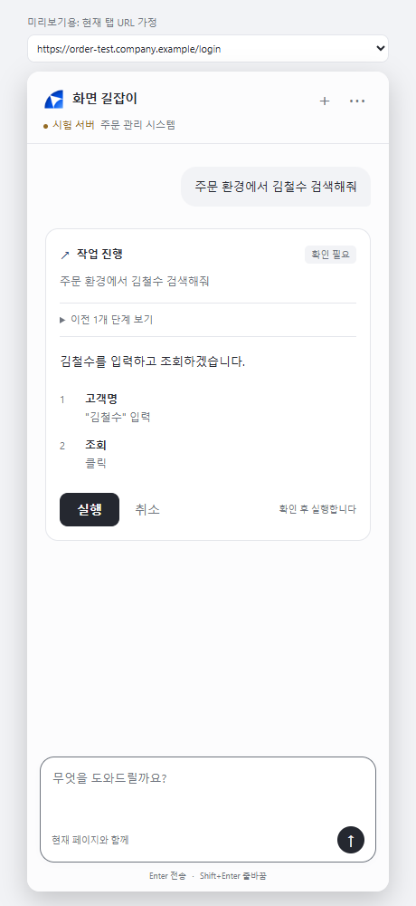
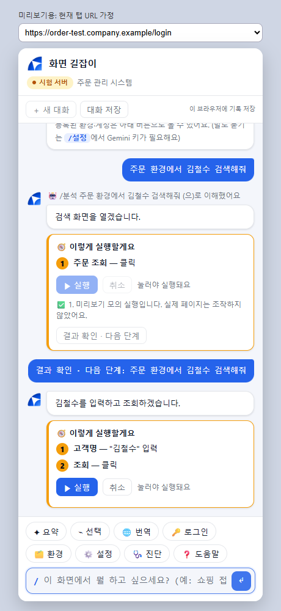
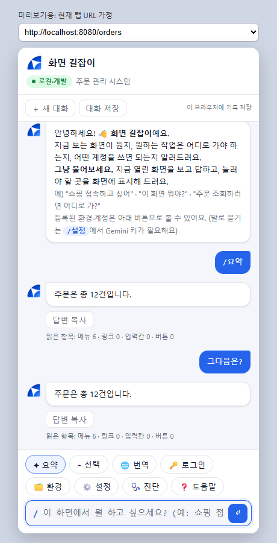
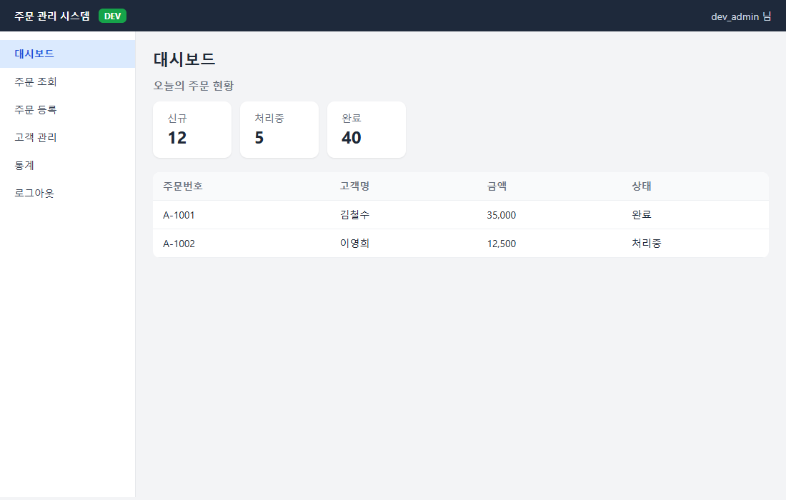
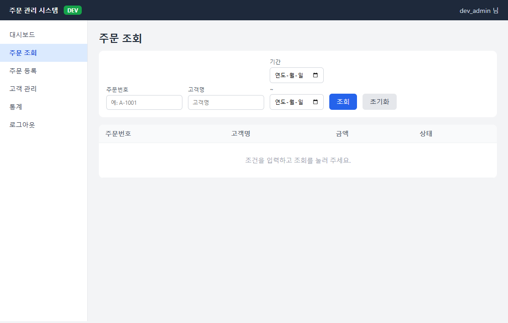
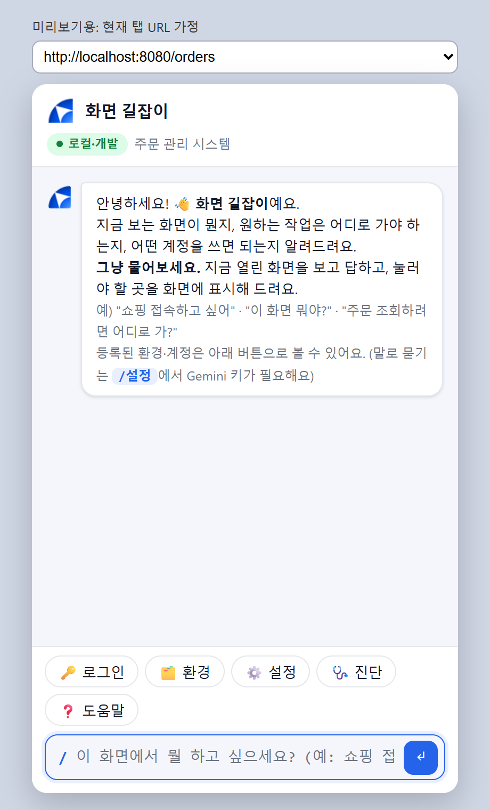
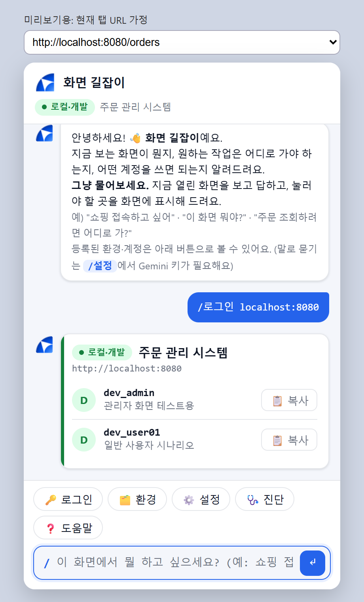
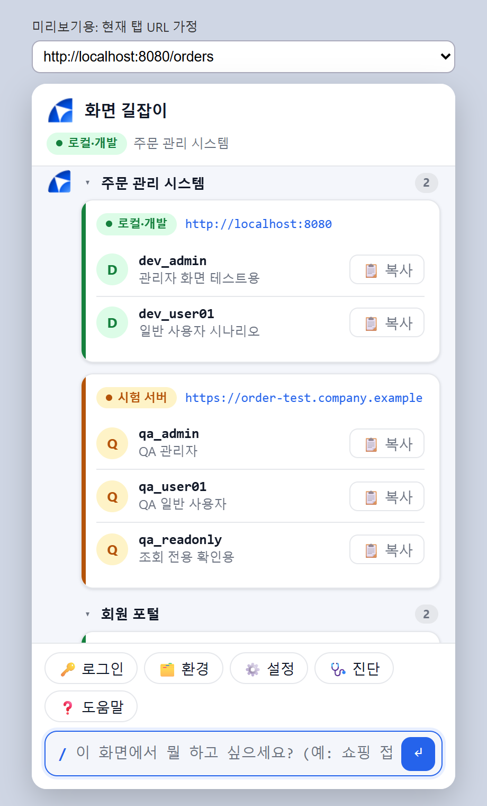

# 화면 길잡이 (데모)

지금 보는 화면이 무엇인지 설명하고, 원하는 작업은 어디로 가야 하는지 **화면에 표시**하며 안내하고, 이 환경에서 쓸 계정을 알려주는 크롬 확장 프로그램 데모입니다. 로컬 테스트용입니다.

## 0.8.0 — 대화 중심으로 화면 정리

- **간결한 첫 화면**: 추천 세 개와 대화 입력창을 중심으로 배치했습니다. 도구·환경·설정·진단·대화 내보내기는 우측 상단 **⋯** 메뉴에 있습니다.
- **여러 줄 입력**: Enter로 전송하고 Shift+Enter로 줄을 바꿉니다. 입력창은 내용에 맞춰 늘어나며, 답변 중에는 전송 버튼이 중지 버튼으로 바뀝니다.
- **작업 하나에 카드 하나**: 실행·결과 확인·다음 계획을 같은 카드에서 갱신하고, 지나간 단계는 실행 기록으로 접습니다. 다음 동작은 계속 사용자의 실행 확인을 받습니다.
- **필요할 때만 상세 정보**: 설정은 별도 창에서 열리고, 참고 화면·실행 내역은 펼쳐 볼 수 있습니다. 내부 명령 분류와 자동 생성 사용자 메시지는 표시하지 않습니다.
- **밝은 화면·다크 모드·작은 패널**을 함께 정리했습니다. 기존 운영 환경 차단과 실행 전 검증은 유지합니다.

| 첫 화면 | 작업 진행 |
|---|---|
|  |  |

캡처와 UI 테스트는 로컬 미리보기·가짜 AI 응답으로 수행합니다. 실제 사내 시스템을 조작한 화면이 아닙니다.

<details>
<summary>이전 버전 변경 내용 (0.7.0 · 0.6.0)</summary>

## 0.7.0 — 실시간 답변과 작업 이어가기

- **실시간 답변**: Gemini SSE로 생성되는 답변을 즉시 표시합니다. 스트림이 정상 완료되고 전체 JSON이 검증된 뒤에만 실행 계획을 보여줍니다. 중지·전송 중단 시 미완성 답변은 기록하지 않습니다.
- **결과 확인 · 다음 단계**: 계획을 실행한 뒤 이 버튼을 누르면 원래 요청과 새 화면을 함께 분석합니다. 페이지 이동 후에도 원래 탭에서 다음 계획을 제안하며, 다음 실행 역시 사용자가 확인해야 합니다.
- **탭 고정 검증**: 화면 읽기·캡처·하이라이트를 분석한 탭에 연결하고, 다른 탭이 활성화되거나 로딩 중이면 진행하지 않습니다.
- **동작 경계**: 입력을 순서대로 처리하되 클릭·Enter 뒤에는 멈춰 새 화면에서 결과를 확인하도록 합니다. 화면에 보이는 근거로 완료 여부를 설명하며, 업무 성공을 보장하는 자동 검증은 아닙니다.

사용 예: `김철수 검색해줘` → 계획 확인 후 **실행** → 검색 화면으로 이동 → **결과 확인 · 다음 단계** → 새 계획 확인 후 **실행**.

Gemini 스트림 형식은 [공식 API 문서](https://ai.google.dev/api/generate-content#method:-models.streamgeneratecontent)를 참고했습니다. 아래 캡처와 자동 검증은 로컬 SSE 서버·가짜 AI 응답·확장 API 미리보기로 수행했으며, 실제 Gemini나 사내 시스템에 요청하지 않았습니다.



## 0.6.0 — AI 어시스턴트 업그레이드

- **대화 기억**: 최근 16개 메시지를 함께 참고해 후속 질문에 답합니다.
- **기록 복원**: 최근 60개 메시지를 이 브라우저에 저장합니다. **새 대화** 또는 `/지우기`로 삭제하고, 메뉴의 **대화 내보내기**로 Markdown 파일을 내려받습니다. 스크린샷과 실행 계획은 저장하지 않습니다.
- **요약 · 번역 · 선택**: 버튼 또는 `/요약`, `/번역`, `/선택 [질문]`을 사용하세요. 선택 질문은 웹페이지에서 글을 드래그한 뒤 실행합니다.
- **중지 · 재시도 · 답변 복사**: 답변 대기 중 중지할 수 있고, 분석 실패 시 다시 시도할 수 있습니다. 요청은 60초 후 시간 초과로 종료합니다.
- **화면 읽기 확장**: 본문 최대 24,000자, 선택 영역 최대 12,000자, 표 최대 5개·각 30행, 폼 밖 입력칸을 읽습니다.
- **실행 검증 보강**: 분석한 탭과 화면 분석 식별자를 검사합니다. 페이지 이동·8초 시간 초과를 성공으로 단정하지 않습니다. 비밀번호 폼의 Enter 제출도 차단합니다.

질문·답변은 브라우저 로컬 저장소에 남으며, 후속 분석 시 최근 대화도 Gemini에 전송됩니다. 사용 후 **새 대화**로 기록을 삭제할 수 있습니다.

무인으로 여러 페이지를 실행하는 기능과 iframe·Shadow DOM 내부 읽기는 아직 지원하지 않습니다. 긴 페이지는 위 한도 안에서 읽습니다.



위 이미지는 미리보기 화면과 테스트용 AI 응답으로 검증한 캡처입니다.

### 개발 검증

```powershell
node --test tests/*.test.cjs
# Playwright 설치 후, 실제 API 호출 없이 Chrome UI 통합 검증
npm run test:browser
# 별도 설치 경로는 PLAYWRIGHT_PATH 환경변수로 지정
```

</details>

## 초기 데모 화면

> 모든 계정·환경은 가상의 예시 데이터입니다.

### 1. 연습용 사이트 (개발 환경 `localhost:8080`)
가짜 "주문 관리 시스템"입니다. 개발 환경으로 인식되면 툴바와 화면 상단에 초록 `DEV` 배지가 표시됩니다.





### 2. 사이드 패널 (화면 길잡이)
툴바 아이콘을 누르면 오른쪽에 열리는 대화창입니다. 아래 버튼(로그인·환경·설정·진단·도움말)이나 입력창으로 물어봅니다. 현재 탭의 환경이 상단에 표시됩니다.



**`/로그인`**: 지금 보는 사이트의 환경(로컬·개발)과 쓸 수 있는 계정을 보여주고, **복사** 버튼으로 계정 ID를 바로 복사합니다.



**`/환경`**: 등록된 모든 시스템·환경(로컬·개발, 시험 서버 등)과 계정을 한눈에 봅니다.



> 위 캡처는 `extension/preview.html`(브라우저에서 단독으로 여는 미리보기)로 찍었습니다. 화면 분석·하이라이트는 실제 확장 프로그램으로 설치해야 동작합니다.

## 폴더 구성
| 폴더·파일 | 설명 |
|---|---|
| `manifest.json` | 확장 프로그램 설정. **이 폴더 전체**를 크롬에 로드합니다. |
| `extension/` | 사이드 패널(`sidepanel.*`), 툴바 배지(`background.js`), 화면 읽기·하이라이트(`pagereader.js`), 미리보기(`preview.html`) |
| `shared/` | 확장과 웹이 함께 쓰는 코어: 매칭(`match.js`), 화면(`core.js`), 대화(`chat.js`), Gemini(`gemini.js`), 샘플 데이터(`sample-pack.js`), 스타일 |
| `web/` | 같은 대화 UI의 웹 버전 (화면 분석은 지원하지 않음) |
| `icons/` | 아이티센 심볼 아이콘(16/32/48/128px), 원본 로고(`01_아이티센_Logo_Basic-17.png`), 심볼 원본(`logo-symbol.png`). 이전 나침반 로고는 `old-compass/` |
| `demo-site/` | 연습용 가짜 "주문 관리 시스템" (개발 환경 `http://localhost:8080`에 해당) |

## 크롬에 설치
1. `chrome://extensions` → 우측 상단 **개발자 모드** 켜기
2. **압축해제된 확장 프로그램을 로드합니다** → 이 폴더(`env-accounts-demo`) 선택
3. 코드를 고친 뒤에는 확장 프로그램 카드의 **새로고침(↻)**
4. 툴바 아이콘을 누르면 오른쪽에 사이드 패널이 열립니다. (크롬 114 이상)

## 연습 사이트로 시험하기
```
python -m http.server 8080 --bind 127.0.0.1 --directory demo-site
```
브라우저에서 `http://localhost:8080`을 열면 툴바에 초록 `DEV` 배지가 뜹니다. 사이드 패널에서 아래처럼 해 보세요.
- "주문 조회하려면 어디로 가?" → 사이드 메뉴의 **주문 조회**에 주황 테두리 표시
- 주문 조회 화면에서 "고객명으로 주문 찾으려면?" → **고객명 입력칸**과 **조회 버튼** 표시
- `/분석`, `/로그인`, `/환경 주문`, `/도움말`

## 사용법
**그냥 물어보세요.** `/` 없이 입력한 말은 기본적으로 **현재 화면 분석**으로 처리합니다. (예: "쇼핑 접속하고 싶어", "카페 어떻게 들어가") 답변과 함께 눌러야 할 곳이 화면에 표시됩니다.
등록된 환경·계정은 우측 상단 **⋯** 메뉴의 로그인·환경에서 보거나, "주문 시스템 시험서버 계정 알려줘"처럼 말로 찾습니다. 설정·진단·도움말도 같은 메뉴에 있습니다.

## 명령
| 명령 | 동작 |
|---|---|
| `/분석 [질문]` | (말로 묻는 기본 동작) 현재 화면을 읽고 스크린샷과 함께 자연어로 답하고, 안내한 항목을 화면에 표시 |
| `/진단` | 연결 점검: 버전, 사이트 접근 권한, 화면 읽기, 스크린샷, Gemini. 안 될 때 가장 먼저 실행 |
| `/로그인 [주소]` | 현재 사이트(또는 지정 주소)의 환경과 계정 |
| `/환경 [키워드]` | 전체 환경 목록, 검색 |
| `/설정` | Gemini 키·모델 |
| `/도움말`, `/지우기` | |

계정·환경을 묻는 말이 아니면 분류 호출 없이 바로 화면 분석으로 갑니다. (속도와 호출 수 절약)

## 데이터 수정
환경·계정은 `shared/sample-pack.js`에서 바꿉니다. 모두 가상의 예시입니다. 운영 도메인 패턴(`prodPatterns`)에 걸리는 URL은 자동으로 제외됩니다.

## 알아둘 점
- **`shared/local-config.js`에 Gemini 키가 들어 있습니다.** 이 폴더를 다른 사람에게 보내거나 압축해서 공유하기 전에 이 파일을 빼세요. (`/설정`에서 입력한 키가 있으면 그쪽이 우선합니다.)
- 화면 분석은 **명령을 실행했을 때만** 화면을 읽습니다. 입력칸의 값(비밀번호 포함)은 읽지 않고, 운영 도메인은 거부합니다.
- 분석할 때 화면 텍스트·구조·**스크린샷**과 현재 환경의 계정 ID·메모가 Gemini로 전송됩니다.
- 확장 프로그램은 **모든 사이트(`<all_urls>`)** 접근 권한을 사용합니다. 스크린샷 캡처에 필요합니다. (배포 전 축소 방안 필요)
- 코드를 고친 뒤에는 `chrome://extensions`에서 새로고침(↻)하고, `/진단`의 "확장 프로그램 버전"으로 반영 여부를 확인하세요.
- **브라우저 이동:** "이전 화면으로 가려면", "새로고침" 같은 질문에는 단축키(Alt+←, F5)를 안내하고, 답변 안의 **이동 버튼**을 누르면 실제로 이동합니다. (버튼은 사용자가 눌렀을 때만 동작)
- **`/진단`은 일반 웹사이트(http/https) 탭에서 실행하세요.** `chrome://` 같은 크롬 내부 페이지는 크롬이 확장 프로그램의 접근을 막아서 ⚠️로 표시됩니다. 이 경우 권한 문제가 아닙니다.
- **확인 후 실행:** "아이티센 검색해줘", "고객명에 김철수 입력하고 조회해줘"처럼 **대신 해 달라고** 하면, 실행 계획 카드(번호·대상·동작)가 뜨고 **[▶ 실행]을 눌러야만** 실행됩니다. [취소]도 가능합니다.
  - 허용 동작: 입력, Enter, 클릭. 말한 동작만 계획에 들어갑니다("입력해줘"면 입력만).
  - 입력하는 글은 내가 말한 내용만 허용합니다. 화면에 적힌 문구가 시키는 입력은 거부합니다.
  - **직접 해야 하는 동작**(비밀번호 입력, 삭제·결제·전송·확정·로그아웃, 비밀번호가 있는 로그인)은 대신 하지 않고 해당 위치만 표시합니다.
  - 운영 환경, 화면이 바뀐 경우에는 실행하지 않습니다. "어떻게 해?"처럼 방법만 물으면 실행 없이 안내합니다.
- 하이라이트는 안내용이고, 실행은 위 계획 카드에서만 합니다. 순서가 있는 작업은 ①②처럼 **번호와 짧은 설명**으로 표시하고, 첫 번째 항목(예: 검색창)에 포커스를 둡니다.
- **접힌 메뉴(☰, 드롭다운):** 원하는 곳이 접혀 있으면 먼저 ☰ 같은 **메뉴 펼치기 버튼**을 표시하고 "펼친 뒤 선택"하라고 안내합니다. 펼친 뒤 다시 물으면 다음 단계를 표시합니다.
- 표시는 **대상의 실제 위치를 계속 따라갑니다.** 표시한 뒤 사이트가 화면을 다시 배치하거나 스크롤해도 어긋나지 않습니다.
- 표시는 **안내한 항목을 직접 누르거나 60초 뒤** 사라집니다. 화면의 다른 곳을 눌러도 유지됩니다. 지금 화면에 보이지 않는 항목은 "표시했어요"라고 하지 않고 사실대로 알립니다.
- iframe·Shadow DOM 안의 항목은 읽지 못합니다. (표시 자체는 Shadow DOM 안에 그려서 사이트 스타일에 가려지지 않습니다.)
- 나이스(Nexacro) 같은 화면은 메뉴가 링크가 아니라 버튼으로 구성되어 "메뉴 0 · 버튼 N"으로 읽힙니다. 정상입니다.
- 스크린샷 썸네일을 누르면 크게 볼 수 있습니다. (이미지를 누르면 원본 크기)
- 화면 읽기는 메뉴 링크 60개, 그 밖의 링크 80개(지금 보이는 것 우선), 입력칸, 버튼을 대상으로 합니다.
